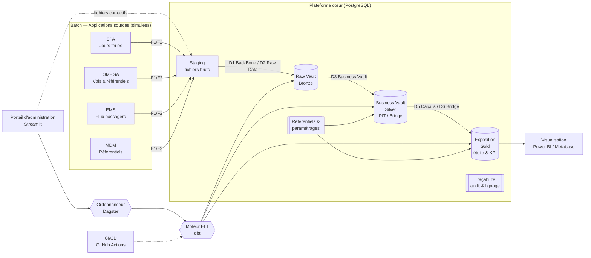

# ✈️ Aero Data Archi — Plateforme Data aéroportuaire (Data Vault & Médaillon)

> Projet personnel d'apprentissage : reproduire, à échelle réduite et avec des outils open source,
> l'architecture data d'une plateforme aéroportuaire : **Batch → Staging → Raw Vault (Bronze)
> → Business Vault (Silver) → Exposition (Gold) → Visualisation**, avec un ordonnanceur ELT,
> un portail d'administration et une chaîne CI/CD.
>
> ⚠️ Projet pédagogique. Toutes les données sont **simulées** ou issues de l'**open data**. Aucune
> donnée ni aucun code d'un aéroport réel n'est utilisé.

## 🎯 Objectifs

| Objectif | Compétence démontrée |
|---|---|
| Modéliser un entrepôt en **Data Vault 2.0** (Hubs, Links, Satellites, PIT, Bridge) | Data Architecture / Modélisation |
| Construire une chaîne **ELT** de bout en bout avec dbt | Analytics Engineering |
| Orchestrer les traitements (DAG, reprise, planification) | Data Engineering / DataOps |
| Garantir **qualité** et **traçabilité** (tests, lignage, audit des chargements) | Gouvernance des données |
| Exposer des **KPI opérationnels** dans un modèle en étoile et des tableaux de bord | BI & Aide à la décision |
| Proposer un **portail d'administration** (dépôt de correctifs, suivi des runs) | Produit data |
| Industrialiser avec **CI/CD** (GitHub Actions) | DataOps |

## 🏗️ Architecture cible



Le détail de chaque couche est décrit dans [`docs/architecture.md`](docs/architecture.md).

## 🧰 Stack technique

| Bloc | Outil | Pourquoi |
|---|---|---|
| Sources batch | Python + Faker | Génération de fichiers CSV/JSON réalistes |
| Stockage / SGBD | PostgreSQL 16 (Docker) | SGBD relationnel unique pour les 3 couches |
| ELT / Modélisation | dbt-core + `automate_dv` | Data Vault 2.0 industrialisé en SQL |
| Orchestration | Dagster | Assets, lignage natif, intégration dbt |
| Qualité | tests dbt (+ Great Expectations en option) | Contrôles automatisés à chaque run |
| Portail | Streamlit | Dépôt de correctifs, suivi des chargements |
| Visualisation | Power BI Desktop + Metabase | Power BI pour la richesse, Metabase pour la démo open source |
| CI/CD | GitHub Actions | Lint SQL, `dbt build` sur base éphémère |
| Transposition cloud | Microsoft Fabric (doc) | Correspondance Lakehouse / Warehouse / Pipelines |

## 🛫 Cas d'usage métier

Domaine : **opérations aéroportuaires** (vols, passagers, ressources).

- **Ponctualité** : taux de vols à l'heure par compagnie, terminal, créneau horaire
- **Ressources** : taux d'occupation des portes et des postes de stationnement
- **Flux passagers** : temps d'attente moyen aux contrôles, pics de fréquentation
- **Saisonnalité** : impact des jours fériés et des vacances scolaires sur le trafic

Voir le [dictionnaire de données](docs/dictionnaire_donnees.md).

## 📁 Arborescence

```
Aero_data_archi/
├── docs/                     # Architecture, modèle de données, feuille de route, ADR
├── ingestion/generators/     # Simulateurs des applications sources (Batch)
├── data/landing/             # Zone d'atterrissage des fichiers (non versionnée)
├── sql/init/                 # Création des schémas PostgreSQL (staging, raw_vault, …)
├── dbt/                      # Projet dbt : staging → raw_vault → business_vault → marts
├── orchestration/            # Ordonnanceur (Dagster)
├── portal/                   # Portail d'administration (Streamlit)
├── visualization/            # Rapports Power BI / Metabase
├── .github/workflows/        # CI/CD
└── docker-compose.yml
```

## 🚀 Démarrage rapide

```bash
# 1. Démarrer PostgreSQL
cp .env.example .env
docker compose up -d postgres

# 2. Générer des fichiers sources simulés
python -m venv .venv && source .venv/bin/activate
pip install -r requirements.txt
python ingestion/generators/generate_flights.py --days 30

# 3. Construire les couches avec dbt
cd dbt && dbt deps && dbt seed && dbt build
```

## 🗺️ Feuille de route

| Phase | Contenu | Statut |
|---|---|---|
| 0 | Structure du dépôt, README, architecture, Docker | ✅ |
| 1 | Générateurs de données sources + staging | 🟡 en cours |
| 2 | Raw Vault (Hubs / Links / Satellites) | ⬜ |
| 3 | Business Vault (PIT, Bridge, règles métier) | ⬜ |
| 4 | Couche Gold (modèle en étoile, KPI) + tests qualité | ⬜ |
| 5 | Orchestration Dagster + traçabilité des runs | ⬜ |
| 6 | Portail d'administration Streamlit | ⬜ |
| 7 | Tableaux de bord Power BI / Metabase | ⬜ |
| 8 | CI/CD complète + transposition Microsoft Fabric | ⬜ |

Le détail est dans [`docs/roadmap.md`](docs/roadmap.md).

## 👤 Auteur

**Christophe KOUADIO**, Consultant Senior Data & Analytics (Data Architecture, BI, Microsoft Fabric).
Projet réalisé dans le cadre de ma montée en compétences en Data Engineering et Data Architecture.

*Architecture inspirée d'un schéma public de plateforme data aéroportuaire, réinterprétée à des fins
pédagogiques.*
